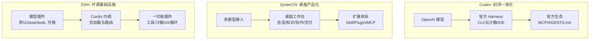

# AI Agent 平台对比：Codex、QoderCN、DeepSeek Harness

> 一句话定义：**这三个产品都是"Harness"（Agent 运行基础设施）——模型之外的那一整套执行环境：工具、循环、沙箱、记忆、界面。公式 `Agent = Model + Harness`：模型负责想，Harness 负责把事办成。三者的分歧在于开放程度、产品形态与生态路线。**

系列导航：[Token的详解](../Token/Token的详解.md) → [大模型LLM详解](../LLM大模型/大模型LLM详解.md) → [AI-Agent详解](../Agent智能体/AI-Agent详解.md) → [MCP协议详解](../MCP插件/MCP协议详解.md) → [插件详解](../MCP插件/插件详解.md) / [Skill详解](../Skill技能/Skill详解.md) / [连接器详解](../connector连接器/连接器详解.md) / [工具集详解](../工具集/工具集详解.md) / **平台对比**

> 时效声明：本文信息截至 2026 年 11 月，AI 平台迭代极快，关键决策前请核对官方文档。

---

## 1. Why：为什么"Harness"成了主战场

### 1.1 模型趋同，执行分层

2025~2026 年，头部模型的编码与推理能力差距缩小，用户发现：**同一个模型，放在不同平台里，干活能力天差地别**。原因在模型之外：

- 工具集设计得好不好（见[工具集详解](../工具集/工具集详解.md)）
- 上下文与记忆管理得怎么样
- 沙箱与权限是否让人敢放手
- 循环调度、子代理、轨迹回放等工程能力

这套东西统称 **Harness**（原意"马具/挽具"——模型是马，Harness 是马鞍与缰绳）。DeepSeek 把 `Agent = Model + Harness` 作为公开的产品哲学，OpenAI、Anthropic 也在沿同一方向演进（Claude Agent SDK、Codex 的 Agents API 化）。

### 1.2 三条路线的分野

| 路线 | 代表 | 逻辑 |
|------|------|------|
| **封闭一体化** | OpenAI Codex | 模型 + Harness + 云端托管打包卖体验，Harness 能力再服务化（Agents API） |
| **桌面产品化** | QoderCN | 面向开发者的完整桌面工作台，Harness 能力产品化为开箱即用的功能 |
| **开源基础设施** | DeepSeek Harness | MIT 开源、一切皆插件，做"Agent 界的 Linux"，生态共建 |

> **为什么值得学：** 选平台就是选 Harness。理解三条路线，你就能判断：自己的场景要体验、要工作台、还是要可控的底座。

---

## 2. What：三个平台分别是什么

### 2.1 OpenAI Codex

OpenAI 的编码 Agent 产品线，多形态入口：

- **Codex CLI**：终端里的编码 Agent（开源），本地读写代码、跑命令。
- **Codex 云端**：ChatGPT 内的云沙箱任务——派活后云端并行执行，回传 PR。
- **IDE 扩展**：编辑器内集成。
- 绑定 OpenAI 自家模型（codex/GPT 系列），支持 MCP 与 AGENTS.md 项目约定。
- 2026 年趋势：Codex Harness 能力被封装为 **Agents API**，向企业输出"Agent 执行即服务"（据报道，细节以官方为准）。

### 2.2 QoderCN（Qoder 国内版桌面端）

面向开发者的 AI 桌面工作台，也就是你当前正在使用的环境。可观察到的核心能力：

- **Agent 会话**：内置工具集（文件/命令/搜索/任务管理）+ 子代理委派 + 权限模式。
- **扩展体系**：Skills、Plugins、MCP 连接器、浏览器连接器（本系列前几篇文档的机制全部在此落地）。
- **知识层**：Repo Wiki（代码库知识卡）、Knowledge Bases（QMind 笔记本）、长期记忆系统。
- **协作与交付**：Desktop Team 多代理团队、协作平台（Project/Issue/Discussion）、Sites 建站部署、Canvas 可视化、定时任务。
- 模型侧接入多家模型服务，不绑定单一模型。

### 2.3 DeepSeek Harness（DSH）

深度求索 2026 年 8 月随 V4 Pro 发布的 **MIT 开源 Agent 基础设施**，发布数日 GitHub Star 破 10 万（据媒体报道）：

- **哲学**：`Agent = Model + Harness`，"一切皆插件"。
- **架构**：基于 Cordis 插件内核——内核只管插件加载、生命周期与依赖路由；模型接口、工具、Skill、会话、沙箱、存储、循环、调度、UI **全部是插件**，在 YAML/JSON 配置层替换重组，不改源码。
- **四种预设模式**：标准（全功能编码 Agent）、PTC（模型写 TypeScript 代码组合工具调用）、极简（仅 bash + 编辑器，用于模型基准评测）、创造（内存中试验插件）。
- **Trajectory 轨迹**：仅追加（Append-Only）会话日志，记录系统提示、思维链、工具调用全过程，支持恢复、分叉、回放。
- **形态**：`npx @deepseek-ai/dsh web` 起 Web UI；官方桌面端（apps/desktop）支持 macOS Apple Silicon/Intel 与 Windows x64（暂不支持 Linux）；与 V4.1 Flash 联合优化。
- **前沿**：2026 年 10 月底开源 Super-agent 研究原型（dsh-superagent-prototype），探索跨会话自主调度——官方明确是研究原型而非产品。

---

## 3. How：架构机制对比

### 3.1 分层视角



### 3.2 关键机制差异

| 机制 | Codex | QoderCN | DeepSeek Harness |
|------|-------|---------|------------------|
| 扩展方式 | MCP + AGENTS.md | Skill/Plugin/MCP/子代理 | Cordis 插件（连内核能力都可换） |
| 执行环境 | 本地 CLI / 官方云沙箱 | 本地桌面 + 权限模式 | 插件化沙箱，可自定义 |
| 可观测性 | 任务日志 | 会话轨迹 + 任务列表 | Trajectory 全量事件流，分叉/回放 |
| 工具调用 | 声明式 Function Calling | 声明式 + 懒加载 | 声明式 + PTC 代码化 |
| 记忆/知识 | 会话 + 项目约定 | 长期记忆 + Repo Wiki + 知识库 | 存储插件，自行组合 |
| 多代理 | 云端并行任务 | 子代理 + Desktop Team | 子代理插件 + Super-agent 探索 |

### 3.3 一个值得理解的细节：PTC 模式

传统工具调用：模型每步输出一个 JSON 调用，循环分支靠多轮往返。PTC（Programmatic Tool Calling）：把工具暴露成 TypeScript SDK，模型**写一段程序**表达"循环查 10 个商品、库存低于阈值就汇总"——一次执行完成复杂编排。这是[工具集详解](../工具集/工具集详解.md)第 6.2 节趋势的落地实例，也解释了 DSH 为什么强调沙箱：模型写的代码真的要跑。

---

## 4. Do：快速上手路径

### 4.1 Codex

1. 准备 ChatGPT 订阅或 OpenAI API Key。
2. 安装 Codex CLI（npm 安装，见官方仓库 openai/codex）。
3. 在项目目录运行，用 AGENTS.md 写项目约定。
4. 云端模式：在 ChatGPT 的 Codex 入口连接仓库、派任务。

### 4.2 QoderCN

1. 官网下载国内版桌面端，登录。
2. 打开项目目录，直接对话派活；用权限模式控制放权程度。
3. 按需装 Skill/插件、配 MCP 连接器（本系列文档即操作指南）。
4. 进阶：生成 Repo Wiki、配置长期记忆、组建 Desktop Team。

### 4.3 DeepSeek Harness

1. 准备 Node.js 环境与 DeepSeek API Key。
2. 一行启动 Web UI：

```bash
npx @deepseek-ai/dsh web
```

3. 或克隆源码 `deepseek-ai/deepseek-harness` 本地部署，配置文件层组合插件。
4. 桌面端从官方下载渠道获取（macOS/Windows）。
5. 社区插件：GitHub Topic `dsh-plugin`；官方文档：deepseek-harness.github.io/deepseek-harness/guide/quickstart。

---

## 5. Where：选型场景

| 你的情况 | 建议 |
|----------|------|
| 要最强开箱体验、已在 OpenAI 生态 | Codex（云端派活 + CLI） |
| 日常开发主力工作台、要知识库/团队/国内服务 | QoderCN |
| 要私有化、审计源码、深度定制 Agent 底座 | DeepSeek Harness |
| 研究 Agent 架构、做基准评测 | DSH（极简模式 + Trajectory 回放） |
| 企业内网、数据不出域 | DSH 自部署 或 QoderCN 私有化方案（以官方商务为准） |
| 学习 Agent 原理 | DSH 源码（MIT 可读）+ 本系列文档 |

组合使用很常见：QoderCN 做日常工作台，DSH 做定制底座实验，Codex 云端跑批量任务——Harness 之间不互斥。

---

## 6. Compare：总对比表

| 维度 | Codex | QoderCN | DeepSeek Harness |
|------|-------|---------|------------------|
| 厂商 | OpenAI | Qoder（国内版桌面端） | 深度求索 |
| 开源 | CLI 开源，云端闭源 | 闭源产品 | **MIT 全开源** |
| 模型绑定 | OpenAI 系 | 多模型接入 | 默认 DeepSeek，插件可换 |
| 形态 | CLI + 云 + IDE | 桌面工作台 | Web UI + 桌面端 + 源码 |
| 扩展哲学 | 官方生态 + MCP | Skill/Plugin/MCP 体系 | 一切皆插件（Cordis） |
| 上手成本 | 低 | 低 | 中（开发者向） |
| 定制上限 | 中 | 中 | **高（可换内核能力）** |
| 私有部署 | 不支持云端私有 | 以官方方案为准 | **完全支持** |
| 成熟度 | 高 | 高 | 快速迭代（v0.1.x 起步） |
| 适合 | 体验优先 | 工作台优先 | 可控性优先 |

---

## 7. Source：一手资料与信息素养提醒

1. **官方优先**：
   - Codex：OpenAI 官方文档与 GitHub `openai/codex`
   - QoderCN：Qoder 官网与官方文档
   - DSH：GitHub `deepseek-ai/deepseek-harness`、官方文档站、DeepSeek 公众号技术长文
2. **媒体报道（本文事实核查来源）**：
   - [AIBase：DSH v0.1 开放测试与"一切皆插件"架构](https://news.aibase.com/zh/news/30343)
   - [AIBase：DSH 官方桌面端三大平台支持](https://news.aibase.com/zh/news/31057)
   - [AIBase：DSH 0.1.5 适配 V4.1 Flash](https://news.aibase.com/zh/news/30969)
   - [AIBase：Super-agent 架构开源](https://news.aibase.com/zh/news/32001)
3. **⚠️ 信息素养案例**：社区站 deepseekharness.wiki 内容详实但**非官方**（页脚自述为爱好者社区），其对比表声称"Claude Code 无插件机制、Codex 仅闭源云端"——**均与事实不符**（Claude Code 有 Plugin 体系，Codex CLI 开源）。引用第三方对比表前，逐项对照官方文档核实。这是 AI 时代查资料的典型坑：SEO 站点会把营销话术包装成技术对比。

---

## 8. Future：演进方向

1. **Harness 服务化**：Codex Agents API、Claude Managed Agents、Gemini Managed Agents——"Agent 执行环境"本身成为云产品，企业不必自建。
2. **开源底座生态战**：DSH 的 Cordis 插件生态（dsh-plugin）能否形成网络效应，决定它能否成为"Agent 界 Linux"。
3. **Super-agent / 长时程自主**：跨会话调度、后台自主发现任务（DSH 研究原型已探索），从"人派活"走向"Agent 找活"。
4. **模型与 Harness 联合优化**：V4.1 Flash × DSH 的缓存命中与性能协同表明，"自家模型 + 自家 Harness"的垂直整合会持续加深。
5. **标准层收敛**：MCP（工具）、Skill 格式（知识）、A2A（协作）逐步标准化后，Harness 之间的迁移成本下降，竞争回归工程质量本身。

---

## 自检清单

- [ ] 用"马与马鞍"类比解释 Agent = Model + Harness
- [ ] 说清三条路线（封闭一体化/桌面产品化/开源基础设施）的逻辑
- [ ] 列出 DSH 四种预设模式及各自用途
- [ ] 解释 Cordis"一切皆插件"与传统插件体系的深度差异
- [ ] 解释 PTC 模式相对声明式工具调用的优势与代价
- [ ] 说清 Trajectory 仅追加日志为什么利于审计与实验
- [ ] 为自己的三个场景（学习/日常开发/私有化）各选一个平台并说明理由
- [ ] 举出一个"第三方对比表与事实不符"的实例及核实方法