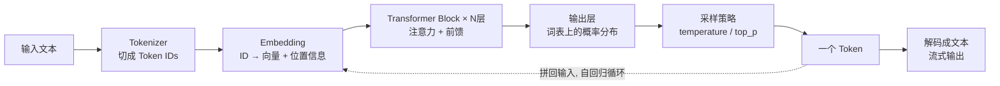
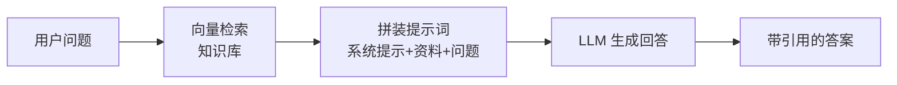

# 大语言模型（LLM）详解

> 一句话定义：**LLM（Large Language Model，大语言模型）是一个用海量文本训练出来的超大规模神经网络，它学会的核心技能只有一个——预测下一个 Token——却在把这个技能做到极致的过程中，涌现出了理解、推理、写作、编程等通用能力。**

前置知识：建议先读同目录的《大模型Token详解.md》，本文会直接使用 Token、词表、上下文窗口等概念。

---

## 1. Why：为什么会出现 LLM

### 1.1 NLP 的三代演进

让计算机处理人类语言，历史上走过三条路：

| 时代 | 思路 | 代表 | 瓶颈 |
|------|------|------|------|
| **规则时代**（1950s~1990s） | 语言学家手写语法规则 | 早期机器翻译 | 语言例外太多，规则写不完 |
| **统计时代**（1990s~2013） | 从语料中统计概率 | n-gram、HMM、CRF | 特征靠人工设计，长距离依赖建模弱 |
| **深度学习时代**（2013~今） | 神经网络自动学表示 | Word2Vec → LSTM → **Transformer → LLM** | 早期模型仍需为每个任务单独训练 |

### 1.2 三个历史性转折点

1. **2017 年，Transformer 架构诞生**（Google 论文 *Attention Is All You Need*）：注意力机制取代循环结构，训练可以大规模并行，长距离依赖建模能力质变。
2. **2018~2020 年，"预训练 + 微调"范式确立**（BERT、GPT 系列）：先在海量无标注文本上学通用语言能力，再用少量数据适配具体任务。GPT-3（2020，1750 亿参数）证明了**规模本身带来质变**——不用微调，给几个示例就能做新任务（In-Context Learning）。
3. **2022 年，RLHF 让模型"听话"**（ChatGPT）：用人类反馈强化学习把"续写机器"调教成"对话助手"，LLM 从实验室走向大众。

### 1.3 为什么是现在爆发

三要素同时到位：**数据**（互联网积累了人类几乎全部公开文本）、**算力**（GPU 集群 + 并行训练技术）、**算法**（Transformer + Scaling Law）。缺一不可。

> **为什么值得学：** LLM 正在成为软件的"新运行时"——就像数据库之于 CRUD 应用。你在做的 FastGPT 问答助手、探索的 OpenMAIC 课堂生成，底层全是 LLM。理解它的原理和边界，才能判断"哪些需求它做得到、哪些是幻觉"。

---

## 2. What：LLM 是什么与不是什么

### 2.1 核心定义拆解

**"大"在哪里：**

- **参数大**：模型内部可学习的权重数量，从 7B（70 亿）到数千亿甚至万亿级。参数就是模型的"知识存储"。
- **数据大**：预训练语料以万亿 Token 计，相当于几百万本书。
- **算力大**：一次预训练消耗数千张 GPU 运行数周至数月，成本数百万到数亿美元。

**"语言模型"的本义：** 一个概率模型，给定前文，输出下一个 Token 的概率分布：

```
P(下一个Token | 前面所有Token)
```

仅此而已。它不查数据库、不执行搜索、不"思考后回答"——它只是在算概率。所有看似智能的行为，都是这个概率模型足够大、训练足够好之后的**涌现能力（Emergent Abilities）**。

### 2.2 关键术语表

| 术语 | 含义 |
|------|------|
| **参数（Parameters）** | 网络中的权重数值，训练的成果就存在这里；"7B/70B"指参数个数 |
| **预训练（Pre-training）** | 在海量文本上做"预测下一个 Token"的自监督学习，占全部训练成本的 95%+ |
| **微调（Fine-tuning / SFT）** | 用高质量"指令→回答"数据教模型按人类意图对话 |
| **RLHF / DPO** | 用人类偏好数据进一步对齐：让回答更有用、更诚实、更无害 |
| **上下文学习（In-Context Learning）** | 不改动参数，仅靠提示词里给的示例/资料临时学会任务 |
| **幻觉（Hallucination）** | 模型一本正经地编造事实——概率模型的天性，无法根除只能缓解 |
| **温度（Temperature）** | 采样随机度：0 接近确定性输出，越高越随机发散 |
| **知识截止（Knowledge Cutoff）** | 训练数据的时间边界，之后的事模型不知道（除非联网检索） |
| **MoE（Mixture of Experts）** | 混合专家架构：每次只激活部分参数，用低成本撑起大参数量 |

### 2.3 能力边界清单

**擅长：** 文本生成与改写、总结、翻译、代码生成、结构化抽取、常识问答、按示例模仿格式。

**不擅长（原生状态下）：**

- 精确计算与数数（它看到的是 Token 碎片，不是数值）
- 实时信息（股价、天气、今天的新闻）
- 私有知识（你公司的内部文档、你的数据库）
- 严格逻辑保证（可能推理出错且毫无察觉）
- 真正的"记住你"（跨会话无记忆，除非外部存储）

**工程对策**：不擅长的部分交给工具——计算给代码解释器、实时信息给搜索 API、私有知识给 RAG、记忆给数据库。这就是 Agent 和 RAG 存在的根本原因。

---

## 3. How：原理与机制

### 3.1 Transformer：LLM 的引擎

一个 LLM 的主体是几十到上百层堆叠的 Transformer Block，每层做两件事：

1. **自注意力（Self-Attention）**：让每个 Token "环顾"前文所有 Token，按相关性加权吸收信息。这是模型理解长距离依赖的核心——"它"指代谁、动词对应哪个主语，都靠这一步。
2. **前馈网络（FFN）**：对每个位置的向量做非线性变换，一般认为模型的"知识"大量存储在这部分的参数里。

整体数据流：



注意力的直觉版解释：处理"小明把书放进书包，因为**它**太重了"时，"它"这个位置的注意力会高度聚焦到"书"上——权重是训练中自动学出来的，不是人写的规则。

### 3.2 训练三部曲：从续写机器到助手

1. **预训练（Pre-training）**
   - 任务：海量文本上做"预测下一个 Token"，答错了就反向传播调参数。
   - 产物：**基座模型（Base Model）**。它博览群书但不会对话——你问它问题，它可能续写出更多问题，因为语料里问题后面常跟着问题。
2. **监督微调（SFT）**
   - 任务：用几万~几百万条人工编写/筛选的"指令→优质回答"样本继续训练。
   - 产物：学会"被问就答"的对话格式与基本行为。
3. **偏好对齐（RLHF / DPO）**
   - 任务：人类对多个候选回答排序，训练模型偏向人类喜欢的风格（有用、诚实、无害）。
   - 产物：你实际用到的 Chat 模型。

一个常见误解：**对齐不注入新知识，只改变行为方式**。知识几乎全部来自预训练。

### 3.3 推理：一次回答是怎么生成的

1. 你的提示词（含系统提示、历史、RAG 资料）被切成 Token 序列送入模型。
2. **Prefill 阶段**：并行处理全部输入 Token，建立 KV Cache（注意力的中间结果缓存）。这一步决定"首字延迟"。
3. **Decode 阶段**：逐个生成输出 Token，每个都要跑一轮完整前向计算。这一步决定"打字速度"（每秒 Token 数）。
4. 每步在词表概率分布上采样：`temperature=0` 时永远选概率最高的（贪心），调高则允许选次优项，带来多样性。
5. 直到生成结束符或达到 `max_tokens`。

由此可推出两个工程事实：**输入越长首字越慢，输出越长总时长越久**；输出单价高于输入，因为每个输出 Token 都是一轮独立推理。

### 3.4 Scaling Law：为什么"大"就是好

OpenAI 2020 年的研究发现：模型性能（测试损失）随**参数量、数据量、算力**的增长呈可预测的幂律下降。这意味着"砸规模"不是玄学而是有曲线可依的工程决策。后续 DeepMind 的 Chinchilla 定律进一步指出：给定算力下，参数量和数据量要**按比例配比**（约 1 参数 : 20 Token）才最优——这解释了为什么后来 70B 模型喂的 Token 远超早期千亿模型。

---

## 4. Do：动手用起来

### 4.1 最小示例：调用 OpenAI 兼容 API（Python）

国内主流模型（Qwen、DeepSeek、Kimi 等）和 FastGPT 都提供 OpenAI 兼容接口，学会这一套等于学会所有家。

1. 安装：

```bash
pip install openai
```

2. 运行（以 DeepSeek 为例，换 `base_url` 和 `model` 即可切换厂商）：

```python
from openai import OpenAI

client = OpenAI(
    api_key="你的API密钥",          # 建议放环境变量, 不要硬编码
    base_url="https://api.deepseek.com",
)

resp = client.chat.completions.create(
    model="deepseek-chat",
    messages=[
        {"role": "system", "content": "你是一个简洁的助手，回答不超过3句话"},
        {"role": "user", "content": "用一句话解释什么是Transformer"},
    ],
    temperature=0.7,
    max_tokens=200,
)

print(resp.choices[0].message.content)
print("Token用量:", resp.usage)
```

3. 理解 `messages` 的三种角色：`system`（人设与规则）、`user`（用户输入）、`assistant`（模型历史回复）。**多轮对话 = 把完整历史每次都传过去**，模型本身无状态。

### 4.2 本地跑一个开源模型（Ollama）

1. 安装 Ollama（Windows 直接下载安装包）。
2. 拉取并运行：

```bash
ollama run qwen3:8b
```

3. 本地 API 同样是 OpenAI 兼容格式，`base_url` 换成 `http://localhost:11434/v1` 即可复用 4.1 的代码。8B 模型在 16GB 内存 + 中端显卡的机器上可流畅运行。

### 4.3 关键参数速查表

| 参数 | 作用 | 建议 |
|------|------|------|
| `temperature` | 随机度 | 事实问答/抽取 0~0.3；创作 0.7~1.0 |
| `top_p` | 只从累积概率前 p 的候选中采样 | 与 temperature 二选一调，别同时大改 |
| `max_tokens` | 输出上限 | 按需设置，太小会截断回答 |
| `stream` | 流式输出 | 聊天界面必开，改善体感延迟 |
| `frequency/presence_penalty` | 抑制重复 | 出现车轱辘话时微调 |
| `stop` | 遇到指定字符串停止 | 控制输出格式时有用 |

### 4.4 提示词最小套路

一个可靠的任务提示词包含四要素：**角色 + 任务 + 约束 + 示例**。

```
你是计算机网络课程的助教（角色）。
把下面的概念解释给大二学生（任务）。
不超过150字，用一个生活类比（约束）。
参考风格：把TCP三次握手比作打电话确认双方都能听到（示例）。
概念：滑动窗口
```

---

## 5. Where：工程实践中的 LLM

### 5.1 三种典型应用形态

1. **直接对话/生成**：聊天助手、文案、翻译。LLM 单打独斗。
2. **RAG（检索增强生成）**：私有文档 → 切片 → 向量化入库 → 提问时检索相关片段 → 拼进提示词 → LLM 基于资料作答。**你的 FastGPT 采购问答助手就是这个形态**。它解决"私有知识 + 幻觉 + 知识截止"三大问题，且不需要训练模型。
3. **Agent（智能体）**：LLM 作为"大脑"，循环执行"思考 → 调用工具（搜索/代码/数据库/API）→ 观察结果 → 再思考"，直到完成任务。RAG 可以看作 Agent 的一种特例（工具=检索器）。



### 5.2 选型时要看的工程指标

- **上下文窗口**：决定能塞多少资料（RAG 场景尤其重要）
- **首 Token 延迟 / 生成速度**：决定交互体感
- **输入/输出单价**：乘以你的预估调用量才是真实成本
- **函数调用（Function Calling）与 JSON 输出能力**：做 Agent 和结构化抽取的硬需求
- **中文 Token 效率**：同样窗口能装多少中文（见 Token 文档第 6 节）

### 5.3 常见坑

1. **把 LLM 当数据库用**：问它精确事实（编号、日期、金额）而不给资料，幻觉率极高。正确做法：事实来自检索/数据库，LLM 只负责组织语言。
2. **以为微调能"灌知识"**：SFT 主要改行为风格，灌私有知识的性价比远低于 RAG。
3. **忽略无状态本质**：不传历史，模型就"失忆"；传全历史，Token 费用滚雪球。要做历史摘要或滑动窗口。
4. **temperature=0 也非完全确定**：浮点计算与批次差异仍可能带来微小变化，别拿它做严格幂等保证。
5. **提示词注入（Prompt Injection）**：用户输入或 RAG 检索到的文档里可能藏着"忽略之前的指令"类攻击文本，系统提示与外部内容要做隔离，敏感操作加人工确认。
6. **拿演示效果当生产可靠性**：Demo 跑通 ≠ 稳定。上线前要有评估集（几十~几百条典型问题 + 期望答案），量化回归。

---

## 6. Compare：生态与选型

### 6.1 闭源 vs 开源

| 维度 | 闭源 API（GPT / Claude / Gemini） | 开源权重（Qwen / DeepSeek / Llama） |
|------|-----------------------------------|-------------------------------------|
| 获取方式 | 按 Token 付费调 API | 下载权重，自部署或托管 |
| 能力上限 | 通常代表当期最强水平 | 追赶迅速，头部开源已接近闭源 |
| 数据隐私 | 数据出本机（看厂商协议） | 可完全私有化，内网运行 |
| 成本结构 | 零运维，量大则贵 | 硬件/运维成本高，量大则省 |
| 定制 | 只能提示词/有限微调 | 可全量微调、改架构 |
| 典型场景 | 快速验证、ToC 产品 | 政企内网、数据敏感、深度定制 |

### 6.2 稠密（Dense）vs 混合专家（MoE）

- **Dense**：每个 Token 激活全部参数。70B 模型就要 70B 的算力/显存开销。
- **MoE**：参数分成多个"专家"，路由器每步只挑 2~8 个专家激活。如某 671B MoE 模型每 Token 仅激活 37B——**总参数决定知识容量，激活参数决定推理成本**。DeepSeek-V3/R1、Qwen 的 MoE 版本是代表。
- 代价：显存仍要装下全部参数，部署门槛高；训练更难稳定。

### 6.3 尺寸怎么选

| 规模 | 典型能力 | 适用 |
|------|----------|------|
| 1B~8B | 简单抽取、分类、格式化 | 端侧/低成本高并发、本地实验 |
| 14B~70B | 不错的问答与代码能力 | 私有化 RAG、企业内部助手 |
| 100B+ / 旗舰 API | 复杂推理、长文档、Agent | 生产级复杂任务 |

原则：**先用小模型试，不够再升级**。很多任务（分类、抽取）小模型 + 好提示词就够，成本差一个数量级。

### 6.4 LLM vs 传统机器学习

| 维度 | 传统 ML（分类/回归） | LLM |
|------|----------------------|-----|
| 任务适配 | 每个任务标注数据+单独训练 | 提示词即适配，零样本起步 |
| 输入 | 结构化特征 | 自然语言/代码/多模态 |
| 输出确定性 | 可复现、可校准 | 概率性、需评估集把关 |
| 单次成本 | 极低（毫秒级 CPU） | 较高（GPU 推理） |
| 结论 | 窄而确定的任务仍首选传统 ML | 开放语言任务首选 LLM，两者常组合使用 |

---

## 7. Source：一手资料与深入路径

按由浅入深排序：

1. **直觉入门**：Andrej Karpathy *"Intro to Large Language Models"*（约 1 小时，非技术向全景）→ *"Let's build GPT from scratch"*（约 2 小时，手写一个迷你 GPT）。
2. **奠基论文**：
   - *Attention Is All You Need* (2017)——Transformer 架构
   - *Language Models are Few-Shot Learners* (GPT-3, 2020)——规模与上下文学习
   - *Training Language Models to Follow Instructions with Human Feedback* (InstructGPT, 2022)——RLHF
   - *Scaling Laws for Neural Language Models* (2020)——规模定律
3. **源码**：`karpathy/nanoGPT`（GitHub，约 300 行核心代码复现 GPT-2 训练，配合视频食用）；`karpathy/llm.c`（纯 C 实现，理解底层）。
4. **系统课程**：HuggingFace LLM Course / NLP Course（免费，含中文社区翻译）；Stanford CS324（Large Language Models）。
5. **动手实验建议**：用 Ollama 在本地跑一个 8B 模型，同一问题分别在 temperature 0 / 0.7 / 1.5 下各问 5 次，直观感受采样随机度；再对比 Base 模型与 Chat 模型对同一问题的反应，理解 SFT 的作用。

---

## 8. Future：演进方向

1. **推理模型（Reasoning Models）**：o 系列、DeepSeek-R1 开创了"先想后答"范式——生成大量思考 Token 再给答案，用推理时算力换正确率（Test-time Scaling）。数学、代码能力大幅提升，代价是更慢更贵。
2. **多模态原生化**：文本、图像、音频、视频统一进一个模型（GPT-4o、Gemini），"语言模型"正在变成"世界模型"的入口。
3. **Agent 化**：从"回答问题"到"完成任务"——操作浏览器、写代码跑测试、调用企业系统。可靠性与安全性是当前主战场。
4. **上下文继续膨胀 + 记忆外挂**：1M+ Token 窗口普及，配合外部记忆系统缓解"金鱼记忆"。
5. **小型化与端侧**：蒸馏、量化（4bit 甚至更低）让 7B 级模型跑进手机和 PC，隐私敏感场景不必上云。
6. **成本持续跳水**：同等能力的 Token 单价逐年下降数倍，昨天"用不起"的方案今天可能成立——选型结论要定期重估。

---

## 自检清单

学完本文，试试能否做到：

- [ ] 一句话说清 LLM 的本质（预测下一个 Token 的概率模型）
- [ ] 讲清 Transformer 出现前 NLP 的两代方案及其瓶颈
- [ ] 解释预训练 / SFT / RLHF 各自改变什么、不改变什么
- [ ] 画出"输入 → Embedding → N 层 Transformer → 采样 → 自回归循环"的数据流
- [ ] 说清 Prefill 与 Decode 两阶段分别影响什么指标
- [ ] 用 OpenAI 兼容 SDK 跑通一次带 system/user 消息的调用
- [ ] 解释为什么 RAG 比微调更适合灌私有知识
- [ ] 说出 Dense 与 MoE 的区别、总参数与激活参数各决定什么
- [ ] 举出 3 个 LLM 的工程坑（幻觉、无状态、提示词注入等）及对策
- [ ] 把"LLM 为什么能预测下一个词却显得会推理"讲给同学听