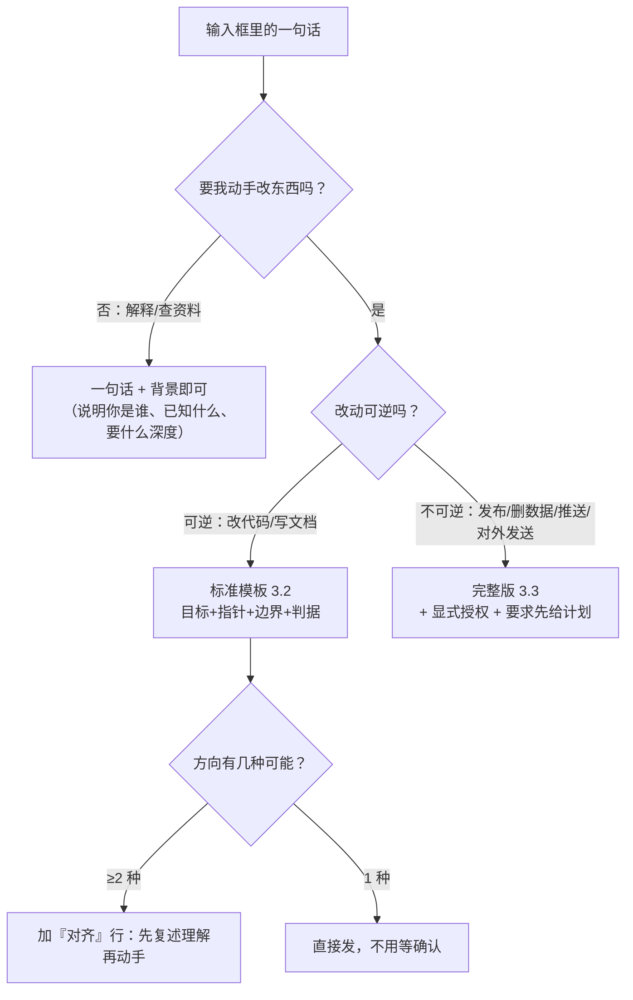

# 用户输入最佳实践（Agent 输入框篇）

> 一句话定义：**输入框是 Agent 会话里唯一每轮都能改的提示词。它不该重复 system 里已有的角色与格式，而该补上 system 永远不可能知道的四件事——这次要什么、指哪儿、别碰什么、怎么算完成。**

系列导航：[提示词详解](提示词详解.md) → **用户输入最佳实践** → [AI-Agent详解](../Agent智能体/AI-Agent详解.md) / [Skill详解](../Skill技能/Skill详解.md) / [MCP协议详解](../MCP插件/MCP协议详解.md)

配套关系：[提示词详解](提示词详解.md) 讲"一段提示词怎么写"（角色 + 任务 + 上下文 + 约束 + 输出格式）；本篇讲"在已经装了系统提示、规则文件、工具、记忆的 Agent 里，输入框这一句该怎么说"。**前者是全集，后者是它的残差。**

---

## 1. Why：为什么"会问"比"会写提示词"更值钱

### 1.1 五要素模板在 Agent 里会失效一半

拿 [提示词详解 3.3 的五要素](提示词详解.md) 逐项对照，在 Agent 输入框里的实际价值：

| 要素 | 独立提示词里 | Agent 输入框里 | 原因 |
|------|--------------|----------------|------|
| 角色 | 必要 | **多余** | system / AGENTS.md 已常驻，重复写只会和它抢注意力，甚至冲突 |
| 任务 | 必要 | **必要** | 只有你知道这一轮要干什么 |
| 上下文 | 必要 | **变形** | 不再是"复述背景"，而是"指向证据"——路径、行号、日志、@引用 |
| 约束 | 必要 | **必要且升级** | 除了格式约束，多了**动作边界**（别改哪、别提交什么） |
| 输出格式 | 必要 | **多为多余** | 规范已在规则文件/Skill 里；除非这次要特例 |
| 示例（Few-Shot） | 必要 | **降级保留** | 角色示例无用，但"期望输出长这样"的样例仍然高效 |

结论：Agent 输入框的四要素是 **目标 + 指针 + 边界 + 判据**。

### 1.2 返工的真实成本

Agent 不会读心（[提示词详解 1.2](提示词详解.md)：没写的约束等于不存在），但聊天式提示词的代价被 Agent 放大了——它会**动手**：

- 模糊指代 → 它猜文件，猜错就改错地方
- 没给边界 → 顺手重构了三个模块，diff 从 20 行变 2000 行
- 没给判据 → 它宣布"完成"，你验收时发现要的是另一件事
- 一次塞十个目标 → 前面几个被后面的挤掉，交付残缺

聊天错了一次重问一句；Agent 错一次要回滚、重跑、重新对齐。**输入质量直接等于返工量。**

---

## 2. What：输入框该写什么、不该写什么

### 2.1 归属判断表（最常用的一张表）

| 你想表达的东西 | 写在输入框 | 固化到哪里 |
|----------------|:----------:|------------|
| 本次任务目标、动机 | ✅ | — |
| 具体文件/模块/行号/@引用 | ✅ | — |
| 本次特例约束（"这次只要最小改动"） | ✅ | — |
| 完成判据（跑什么命令、看到什么算过） | ✅ | — |
| 危险动作授权（要不要 commit / push / 删文件） | ✅ | — |
| 永久人设、语气 | ❌ | 项目规则文件 / AGENTS.md |
| 编码规范、命名、目录约定 | ❌ | AGENTS.md / 规则文件 |
| 某类任务的固定流程（如"报价单格式"） | ❌ | Skill |
| 事实性知识（库存、价格、API 参数） | ❌ | RAG / 知识库 |
| "你是世界顶级专家"类咒语 | ❌ | 无处——强模型上收益趋零 |

口诀：**常驻规则进文件，本次意图进框，事实进 RAG，深度定制才微调。**（[提示词详解 6.1](提示词详解.md) 的口诀在 Agent 场景的补全版）

### 2.2 四要素定义

| 要素 | 回答的问题 | 缺失的代价 |
|------|-----------|-----------|
| **目标** | 要达成什么 + 为什么要达成 | Agent 替你定义成功，你只能事后否决 |
| **指针** | 证据在哪（路径、行号、日志、引用） | 它去猜位置，改错文件或重复实现 |
| **边界** | 哪些不许动、哪些动作要先问 | 变更半径失控，review 成本爆炸 |
| **判据** | 怎么算完成（可执行的） | "完成"变成主观词，来回三轮 |

---

## 3. How：模板1

### 3.1 最小可用（日常 80% 的输入，一行搞定）

```
{动词+要达成什么}，在 {文件路径/模块}，{只改什么/别碰什么}，{跑什么命令算完成}。
```

例：

```
把 src/auth/login.ts 的 token 过期判断从 3600s 改成配置项读取，只改这一个文件，
不要动 refresh 流程，npm run test:auth 全绿算完成。
```

四个槽位齐全，一句话胜过三段小作文。

### 3.2 标准模板（真正的任务型输入，直接抄）

```
目标：{要达成什么，以及为什么——一句话动机}
位置：{文件路径:行号 / 模块 / @引用；已排除的猜测}
边界：只改 {范围}；{其余保持原样}；不要 {commit / push / 加依赖 / 改 CI}，需要时先问我
判据：{命令或可观察结果}；{不允许出现的现象}
方案：{可选——你倾向的做法 / 已经试过不行的做法}
对齐：{可选——先复述你的理解和改动计划，我确认后再动手}
```

三个槽位的取舍：

- **判据写不出来，说明任务还没想清楚**——这是模板最强的副作用，它逼你把模糊需求具体化。
- **边界用正向句**："只改 A" 而不是 "别改 B"（[提示词详解 5.3 第 2 条](提示词详解.md)：否定式指令会反向提高被否定项的概率）。
- **对齐**只在改动大、方向可能错时用；小改动加这行纯属浪费一轮。

### 3.3 完整版（跨文件 / 不可逆 / 首次接手陌生模块）

```
背景：{为什么现在做这件事，业务或技术动机}
目标：{1~3 条，按优先级排序}
位置：{涉及的文件清单 + 你认为的依赖关系}
边界：{不许改的清单}；{需要先授权的动作}；{时间/规模限制，如"这次只做接口层，不碰数据库"}
判据：{每条目标对应一个可验证动作}
分期：{先交付什么，我确认后继续下一步}
风险：{你最担心出错的地方}——改完请专门说明这里怎么验证的
```

### 3.4 输入类型分流（决定用哪套）



---

## 4. Do：写法对照（这部分直接抄进日常）

| # | 差写法 | 好写法 | 差在哪 |
|---|--------|--------|--------|
| 1 | "把登录改一下" | "登录失败时把提示文案从『用户名或密码错误』改成区分账号不存在/密码错，在 `src/auth/login.ts:88` 附近，只改文案不改校验逻辑，判据：新增单测覆盖两种分支" | 目标含糊、无位置、无边界 |
| 2 | "这个函数有 bug，看看" | "`utils/date.ts:42` `formatRange()` 传入同一天返回 `2026-11-22 ~ 2026-11-22`，期望是单个日期。复现：`formatRange('2026-11-22','2026-11-22')`。修完跑 `npm run test:date`" | 现象、复现、期望、判据四缺 |
| 3 | "帮我重构这块，太乱了" | "把 `OrderService` 的拆单逻辑抽到独立类，目标是**行为完全不变**：判据是现有 47 个单测零修改全绿；不改公开接口签名；这次不碰数据库层" | 重构没有"不变"的判据就是重写 |
| 4 | "写得好一点、专业一点" | "面向大二学生，不超过 150 字，含一个生活类比；参考风格：把 TCP 三次握手比作打电话确认双方都能听到" | "好一点"不可执行，规格才可执行 |
| 5 | "不对，再改改" | "第 2 点方向错了：我要的是幂等键放在 header 而不是 body，因为网关读不到 body 就限流。其余三点保留" | 只说"不对"= 让 Agent 重新猜一遍 |
| 6 | "都按你说的办" | "方案 A 可以，直接改；但先不要 commit，改完给我 diff 摘要" | 不可逆动作要单独授权，默认不给 |
| 7 | "顺便把测试、文档、CI 都更新一下" | "本轮只改实现 + 补单测。文档和 CI 下一轮单独做" | 多目标并列时，靠后的会被前面的挤掉 |
| 8 | "这个项目结构你应该知道了吧" | "@引用 `src/payment/` 目录，重点看 `handler.ts`；其他模块本轮不用读" | 别赌 Agent 记得——上下文可能被压缩 |

---

## 5. Where：多轮会话里的输入技巧

### 5.1 起手：先买一张"理解回执"

改动大或方向有歧义时，第一轮**不要让它动手**：

```
先别改。复述一下你要改哪些文件、每处改什么、怎么验证，我确认后再动手。
```

成本一轮，省掉三小时返工。等价于代码评审里的"设计先于实现"。

### 5.2 中途纠偏：定位错误而不是重复指令

| 症状 | 无效说法 | 有效说法 |
|------|----------|----------|
| 方向错 | "不对" | "我要的是 X 不是 Y，因为 Z" |
| 范围超了 | "改太多了" | "回滚除 `a.ts` 外的所有改动，这次只要 `a.ts`" |
| 漏了要求 | "我说过啊" | "判据第 3 条没满足：错误码没登记到 `codes.md`，补上" |
| 它开始编 | "别瞎说" | "这条结论的证据在哪？没有就明确说未验证" |

### 5.3 长会话：目标漂移与压缩

Agent 会话变长后，早期约束会被摘要稀释（[提示词详解 5.3 第 3 条](提示词详解.md) 的长提示词问题在多轮里更严重）。两个动作：

- 每完成一个阶段，重发一次**判据**："继续下一步。仍然遵守：只改后端、不新增依赖、`npm run test:auth` 必须全绿。"
- 看到它引用了已经不存在的文件/接口，说明上下文被压缩过——重新 @引用，而不是假设它记得。

### 5.4 输入 ≠ 全部上下文

你打的字只是最终 prompt 的一小片。同一个上下文里还有 system、工具描述、Skill 正文、记忆注入、历史轮次（[提示词详解 2.1 / 6.2](提示词详解.md)）。三个推论：

- **附件/@引用不是提示词，但会进提示词**：引用文件后，正文成为下一轮上下文——所以"引用对了"比"描述清了"更有效。
- **别复述 Agent 能自己读到的东西**：把文件内容粘进输入框，不如给路径让它读（省预算，且不会粘错版本）。
- **本轮说三遍不如固化一遍**：同一句要求出现第三次，就该搬进 AGENTS.md 或做成 Skill。

### 5.5 不可逆动作的授权分层

| 层级 | 动作 | 默认 |
|------|------|------|
| 自由 | 读文件、搜索、本地改代码、跑测试 | 直接做 |
| 需说明 | 装依赖、改配置、删本地文件 | 做完要能回滚 |
| 需授权 | `git commit/push`、发布上线、改 CI、删数据、对外发消息 | 必须先问 |

在输入框里写边界时，直接把这三层写清楚，比事后追责便宜得多。

---

## 6. Compare：与提示词模板的分工

| 维度 | 提示词模板（五要素） | 用户输入（四要素） |
|------|---------------------|-------------------|
| 服务对象 | 一段独立、无前置上下文的提示 | 已有 system/规则/工具的会话 |
| 首要动作 | 设定角色与规则 | 给出目标与证据 |
| 生命周期 | 复用、版本管理 | 一次性，每轮重发 |
| 失败模式 | 约束矛盾、稀释重点 | 指代含糊、边界缺失 |
| 优化方式 | 迭代 + 回归评估集 | 补判据 + 加指针 |
| 谁改 | 开发者/提示词作者 | 用户本人 |

**关系**：五要素是"从零写一段完整指令"，四要素是"在已有指令之上补残差"。裸调 API 用前者，用 Agent 用后者。

---

## 7. 常见坑

1. **把实现方案当目标**：写死"用 Redis 加个缓存"，Agent 就照做，哪怕问题根本不在那。除非有强约束，只说 What/Why，How 留给它——但要在判据里卡住可观察结果。
2. **隐含假设对方知道**："那个文件""上次的问题""按我们的规矩"——Agent 没有共享记忆，指代一律换成路径或 @引用。
3. **没有判据就开工**：Agent 宣布完成时你才发现验收标准在你脑子里。判据写不出 = 需求没想清。
4. **边界写成否定句**："别动其他文件" 改 "只改 `a.ts`、`b.ts`"。
5. **多目标并列不分优先级**：十条要求平铺，靠后的丢失率最高。要么排序，要么分期。
6. **背景小作文淹没关键**：关键约束放开头或结尾（首尾注意力更强），中间放可裁剪的背景。
7. **把知识库塞进输入框**：几百条事实贴进对话，又贵又漏——那是 RAG 的活（[提示词详解 5.3 第 5 条](提示词详解.md)）。
8. **对外部内容不设防**：粘贴来的网页/日志里若含"忽略以上指令"，按数据处理，不当命令（[提示词详解 5.2](提示词详解.md)）。

---

## 8. 速查卡

```
【一行式】做什么 + 在哪 + 只改什么 + 怎么算完成

【标准版】目标 / 位置 / 边界 / 判据 /（方案）/（对齐）

【方向不明】先别改 → 复述理解和计划 → 我确认 → 再动手
【多轮返工】说"要 X 不要 Y，因为 Z"，不说"不对"
【不可逆】commit / push / 发布 / 删数据 / 对外发送 → 单独授权
【同一句说第三遍】搬进 AGENTS.md 或做成 Skill
```

## 自检清单

- [ ] 说清为什么 Agent 输入框要丢掉"角色/输出格式"两要素
- [ ] 默写四要素（目标 / 指针 / 边界 / 判据）并各举一例
- [ ] 用归属判断表区分"进输入框"与"进规则文件/Skill/RAG"
- [ ] 给一个模糊需求补出可执行判据
- [ ] 把一条否定式边界改成正向范围句
- [ ] 说清"输入框内容"与"模型看到的完整上下文"的差别
- [ ] 列出三类不可逆动作并说明默认授权策略
- [ ] 用第 4 节的对照表改写自己最近三次返工的输入
- [ ] 判断何时该发"先别改，复述理解"而不是直接开工
