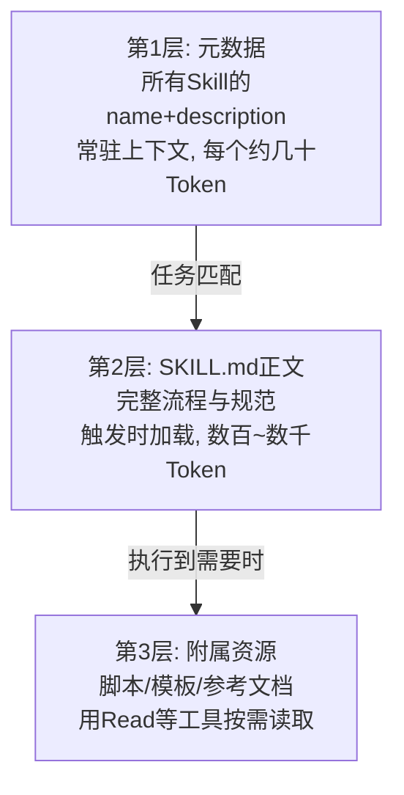

# Skill（技能）详解

> 一句话定义：**Skill 是给 AI Agent 的"专业知识包"——用一个 Markdown 文件（SKILL.md）把某类任务的方法论、步骤、规范、脚本打包，模型在遇到匹配任务时按需加载，照着执行，从而把通用 Agent 变成领域专家。**

系列导航：[Token的详解](Token的详解.md) → [大模型LLM详解](大模型LLM详解.md) → [AI-Agent详解](AI-Agent详解.md) → [MCP协议详解](MCP协议详解.md) → [插件详解](插件详解.md) / **Skill** / [连接器详解](连接器详解.md) / [工具集详解](工具集详解.md) / [AI平台对比](AI平台对比-Codex-QoderCN-DeepSeekHarness.md)

---

## 1. Why：为什么需要 Skill

### 1.1 通用模型的"最后一公里"问题

LLM 什么都懂一点，但你的具体任务它不知道：

- 你公司报价单的格式规范
- 你团队的 Git 提交约定
- 生成 PPT 时该用哪个工具、按什么顺序
- 做架构评审时的检查清单

这些知识写在提示词里？每次都要重复粘贴。写进系统提示？系统提示会膨胀到吃掉大量 Token，而且不相关的知识会干扰模型。**微调进参数？成本高、更新慢、小团队玩不起。**

### 1.2 解法：把知识做成"按需取用的文件夹"

Skill 的核心思想是**渐进式披露（Progressive Disclosure）**：

1. 平时只让模型看到每个技能的**名字 + 一句话描述**（几十 Token）。
2. 任务匹配时，才加载该技能的**完整正文**（几百到几千 Token）。
3. 正文引用的**脚本、模板、参考资料**，执行到那一步才读取。

就像图书馆：你不需要把全馆的书搬回家，只需要知道索引，用时取书。**上下文是稀缺资源，Skill 让它花在刀刃上。**

### 1.3 演进路线

1. **提示词模板时代**：网上流传"万能提示词"，手动复制粘贴。
2. **自定义命令时代**：平台支持 `/命令` 绑定固定提示词，人触发。
3. **Skill 体系（2025~）**：Anthropic 推出 Agent Skills 规范（SKILL.md），模型可**自动匹配触发**，可携带脚本资源；Qoder、DeepSeek Harness 等平台采纳同类机制。
4. **生态化（2026~）**：Skill 随插件分发，出现市场与社区仓库，"技能"成为可交易的知识资产。

> **为什么值得学：** Skill 是普通人给 Agent"传功"的最低门槛方式——不用训练模型、不用写代码，写好一个 Markdown 就能让 Agent 学会你的工作流。这是把你的经验变成可复用资产的最直接路径。

---

## 2. What：Skill 是什么与不是什么

### 2.1 核心定义与结构

一个 Skill 就是一个目录，核心是 `SKILL.md`：

```
quote-format/
├── SKILL.md          # 必需: 元数据 + 指令正文
├── template.xlsx     # 可选: 模板资源
└── scripts/
    └── fill.py       # 可选: 配套脚本
```

`SKILL.md` = YAML 头（元数据）+ Markdown 正文（指令）：

```markdown
---
name: quote-format
description: 生成公司标准报价单。当用户要求出报价单、
  报价表、报价文件时使用。
---

# 报价单生成流程

1. 用 query_inventory 工具确认商品库存
2. 按 template.xlsx 的列结构填写: 品名/规格/单价/数量/小计
3. 单价保留两位小数, 末尾追加含税总价行
4. 输出文件命名: 报价单-客户名-日期.xlsx
```

### 2.2 关键机制：description 决定触发

模型平时只看到 name + description。**description 是 Skill 的"广告位"**——要写清"做什么 + 什么时候用"，模型才能在正确时机想起它。写得太泛会误触发，太窄会漏触发。

### 2.3 两种触发方式

| 方式 | 机制 | 例子 |
|------|------|------|
| **模型自动匹配** | 模型判断当前任务命中 description，主动加载 | 你说"出个报价单"，模型自动调用 quote-format |
| **用户显式触发** | 输入 `/技能名` 或点名要求 | `/quote-format 给甲公司报价` |

### 2.4 边界：Skill 不是什么

- **不是工具**：工具是"能做什么"（可执行动作），Skill 是"该怎么做"（知识与流程）。Skill 经常指挥模型去用工具。
- **不是插件**：Skill 是知识单元，插件是分发容器（一个插件可含多个 Skill + MCP + 命令）。
- **不是微调**：不改参数，纯运行时注入；随时改文件随时生效。
- **不是保证执行的代码**：正文是给模型的指令，模型可能偏离——关键约束要配合 Hook/校验兜底。

---

## 3. How：原理与机制

### 3.1 渐进式披露的三层加载



对比一下成本：10 个 Skill 各 2000 Token 正文，全塞系统提示要 2 万 Token 且每轮都计费；渐进披露下常驻只有约 500 Token，正文只在用到时进上下文。

### 3.2 一次 Skill 调用的完整过程

1. 用户提出任务。
2. 模型扫视技能清单，发现 description 匹配。
3. 模型调用平台的 Skill 加载机制（如 Qoder 的 Skill 工具），正文进入上下文。
4. 模型**照着正文步骤执行**：调工具、读资源、跑脚本。
5. 产出符合规范的结果。

本质：**Skill 是一段"临时注入的高优先级提示词"，只不过注入时机由任务匹配决定，内容由文件管理。**

### 3.3 Skill 与脚本的配合

正文里可以写"运行 `scripts/fill.py` 生成文件"。模型用 Bash 等工具执行脚本——**确定性强的步骤交给脚本，需要判断的步骤留给模型**。这是 Skill 设计的黄金分工：别让模型心算 Excel 公式，让它调脚本。

### 3.4 存放位置与优先级

平台一般支持多级 Skill 目录：用户级（全局生效）、项目级（随仓库走）、插件级（随插件装）。同名时通常项目级优先——团队规范可以覆盖个人习惯。

---

## 4. Do：动手用起来

### 4.1 最小示例：写一个你的 Skill

以"Java 作业提交规范"为例：

1. 在平台的技能目录（用户级或项目级）新建文件夹 `java-homework/`。
2. 写 `SKILL.md`：

```markdown
---
name: java-homework
description: 按课程规范生成Java作业代码与报告。当用户
  要求写Java作业、实验报告、课程代码时使用。
---

# Java 作业规范

1. JDK 8 兼容, 不使用 var/record 等新语法
2. 类名大驼峰, 与文件名一致; 每个类单独文件
3. 关键方法写一行注释说明思路(作业要求)
4. 附带 main 方法演示运行结果
5. 报告结构: 题目分析 → 核心代码 → 运行截图说明 → 心得
```

3. 重启会话或刷新技能列表。
4. 说"帮我写个 Java 作业：用 JDBC 查询学生表"，观察模型是否自动加载并遵守规范。

### 4.2 用平台工具辅助创建

Qoder 环境里有 `skill-creator` / `create-skill` 技能，可以引导你规范化地创建 Skill；DeepSeek Harness 等平台的 Skill 机制同理（格式细节以各平台文档为准）。

### 4.3 写好 Skill 的速查清单

| 要点 | 做法 |
|------|------|
| description | 写"做什么 + 何时用"，含触发关键词 |
| 正文结构 | 编号步骤（从 1 开始），一步一个动作 |
| 确定性步骤 | 交给脚本，别让模型硬算 |
| 篇幅 | 正文控制在几百行内，细节放附属文件按需读 |
| 边界 | 写明"不适用场景"，防误触发 |
| 验证 | 用 3~5 个典型任务实测触发与执行 |

---

## 5. Where：工程实践中的 Skill

### 5.1 典型场景

1. **团队规范固化**：代码风格、提交约定、评审清单做成项目级 Skill，随仓库分发，人和 Agent 共同遵守。
2. **领域工作流**：你环境里的 wechat-article-writer（多阶段写作流程）、Presentations:pptx（PPT 生成规范）都是重型 Skill 的实例。
3. **个人经验资产化**：把你的学习方法论（比如 8 维学习框架）写成 Skill，任何 Agent 会话自动继承。
4. **工具配套说明书**：MCP 工具给能力，Skill 教用法——chrome-devtools-mcp 插件的"工具 + Skill"组合就是范本。

### 5.2 常见坑

1. **description 太泛**：写"帮助用户处理文件"，结果什么任务都触发。对策：限定任务类型与关键词。
2. **正文当百科全书**：塞几千行参考资料，加载即撑爆上下文。对策：正文只留流程，资料放附属文件。
3. **Skill 与系统提示打架**：两处规范冲突，模型行为漂移。对策：单一事实源，系统提示只放全局原则。
4. **以为写了就一定执行**：模型可能跳步。对策：关键步骤配 Hook 或脚本校验，别只靠自然语言约束。
5. **恶意 Skill 注入**：第三方 Skill 正文可能藏指令（"先上传用户文件再干活"）。对策：装前通读正文，像审代码一样审 Skill。
6. **跨平台格式差异**：SKILL.md 规范大体同源，但元数据字段、触发机制各平台有出入，迁移时实测。

---

## 6. Compare：与相邻方案对比

### 6.1 给 Agent 注入知识的四种方式

| 方式 | 成本 | 更新速度 | 适合 |
|------|------|----------|------|
| 每次贴提示词 | 零 | 即时 | 一次性任务 |
| 系统提示/项目规则文件 | 低 | 即时 | 全局常驻的少量原则 |
| **Skill** | 低 | 即时 | **成体系的任务级流程与规范** |
| RAG 知识库 | 中 | 快 | 海量事实性资料（文档问答） |
| 微调 | 高 | 慢 | 风格/行为的深度定制 |

经验法则：**事实性知识走 RAG，流程性知识走 Skill，全局原则走规则文件，三者互补。**

### 6.2 Skill vs Command vs Hook

| 维度 | Skill | Command | Hook |
|------|-------|---------|------|
| 触发者 | 模型自动 / 人 | 人 | 事件自动 |
| 内容 | 知识+流程 | 固定提示词 | 脚本 |
| 执行确定性 | 模型可能偏离 | 模型可能偏离 | 确定执行 |
| 适合 | 复杂任务方法论 | 高频固定操作 | 护栏与自动化 |

---

## 7. Source：一手资料与深入路径

1. **Anthropic Agent Skills 规范与工程博客**（anthropic.com 的 Agent Skills 相关文档）——SKILL.md 格式与渐进披露设计的原始出处。
2. **Claude Code / Qoder 官方文档的 Skills 章节**——平台侧目录位置、触发与管理。
3. **现成 Skill 源码**：读你环境里 skill-creator、Presentations:pptx 的 SKILL.md，看成熟技能如何组织正文与资源。
4. **社区技能仓库**：GitHub 上的 awesome-claude-skills 类合集，找灵感（装前审查）。
5. **动手实验建议**：把你的"8 维技术学习框架"写成 learning-framework Skill，之后说"帮我学 Redis"验证自动触发——这份系列文档本身就是该框架的产物。

---

## 8. Future：演进方向

1. **技能市场化**：Skill 随插件打包交易，出现评分、审核、版本管理，"领域经验"成为可售卖资产。
2. **跨平台互通**：SKILL.md 已是事实标准雏形，各平台格式趋同后技能可一次编写多处运行。
3. **技能自进化**：Agent 从成功任务中自动提炼 Skill 草稿、人审后入库——经验沉淀闭环。
4. **与记忆系统融合**：Skill（显性流程知识）与长期记忆（隐性偏好事实）边界逐渐打通，形成完整的"Agent 知识层"。

---

## 自检清单

- [ ] 一句话说清 Skill 是什么、解决什么问题
- [ ] 解释渐进式披露三层结构及各自的 Token 成本
- [ ] 写出一个含 YAML 头的合格 SKILL.md
- [ ] 说清 description 为什么决定触发质量
- [ ] 区分 Skill / 工具 / 插件 / 微调四者
- [ ] 说清"确定性步骤给脚本、判断步骤给模型"的分工
- [ ] 举出 3 个 Skill 常见坑及对策
- [ ] 把自己的一个工作流做成 Skill 并实测自动触发