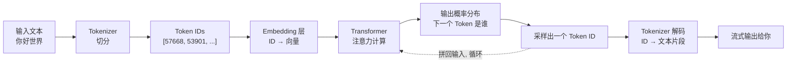

# 自我总结:
1.Token就是大模型按照子词策略划分出来的最小文本处理单位!
2.Token不是单词也不是字符,它是文本处理的单位,在分词表中有自己对应的ID(对应关系)
3.Token在分词表中对应的 ID 就是模型真正"看到"的东西——文本切分成 Token，Token 查词表得到 ID，ID 再变成向量进入神经网络。模型全程不认识文字，只认识这串数字。


# 大模型Token详解
> 一句话定义：**Token 是大语言模型处理文本的最小单位**——模型不认识文字，只认识数字，Token 就是"文本 → 数字"这座桥梁上的基本颗粒。

---

## 1. Why：为什么需要 Token

### 1.1 根本问题：模型只认数字

神经网络的输入必须是数值向量。你输入一句"你好，世界"，模型内部实际收到的是一串整数 ID，比如 `[57668, 53901, 3837, 99489]`。把文本切成一个个单元、再映射成 ID 的过程叫 **分词（Tokenization）**，切出来的每个单元就是一个 Token。

### 1.2 两个失败的前辈方案

在 Token（子词方案）出现之前，有两条路，各有致命缺陷：

| 方案 | 做法 | 致命问题 |
|------|------|----------|
| **按词切分**（word-level） | 每个单词一个 ID | 词表爆炸（英语几十万个词）；遇到没见过的词（新词、拼写错误、专有名词）直接变成 `<UNK>`，信息丢失 |
| **按字符切分**（char-level） | 每个字符一个 ID | 词表极小（几百个），但一句话变成几百个单元，序列太长，计算量暴涨，且单个字符几乎不携带语义 |

### 1.3 折中的智慧：子词（Subword）

**常见词保持完整，罕见词拆成有意义的碎片。** 例如：

- `tokenization` → `token` + `ization`
- `unbelievable` → `un` + `believ` + `able`

这样词表可控（几万到十几万），任何词都能被表示（大不了拆到字节），序列长度也适中。这就是现代所有主流大模型（GPT、Claude、Qwen、DeepSeek、Llama……）都采用 Token 方案的原因。

> **为什么值得学：** Token 是理解上下文窗口、API 计费、RAG 切片、模型多语言能力差异的钥匙。不懂 Token，这些概念全是黑盒。
---

## 2. What：Token 到底是什么

### 2.1 核心定义

- **Token**：分词器（Tokenizer）切分文本后得到的最小单元，对应词表（Vocabulary）中的一个整数 ID。
- **词表（Vocabulary）**：模型训练前就固定好的"Token → ID"对照表，大小常见为 3 万 ~ 25 万。
- **分词器（Tokenizer）**：执行切分的程序，每个模型家族有自己的分词器，**不同模型的 Token 划分互不通用**。

### 2.2 Token ≠ 单词 ≠ 字符

这是最容易误解的地方，看实际例子（以 GPT-4o 的 o200k 分词器为参考，不同模型结果略有差异）：

| 输入文本 | 切分结果（`|` 分隔） | Token 数 |
|----------|---------------------|----------|
| `hello` | `hello` | 1 |
| `hello world` | `hello` \| ` world` | 2 |
| `tokenization` | `token` \| `ization` | 2 |
| `你好` | `你` \| `好`（或合并为 1 个，视词表而定） | 1~2 |
| `人工智能` | `人工` \| `智能` | 2 |
| `1234567` | `123` \| `456` \| `7` | 3 |
| `print("hi")` | `print` \| `("` \| `hi` \| `")` | 4 |

几个关键观察：

1. **空格通常附着在后一个词上**（` world` 是一个 Token，`world` 是另一个）。
2. **高频词一个 Token 搞定，低频词拆成多块**。词表里有没有某个词，取决于训练语料中它出现的频率。
3. **中文比英文"费 Token"**：英文平均 1 个 Token ≈ 0.75 个单词（约 4 个字符）；中文常见 1 个汉字 ≈ 1~2 个 Token（新模型词表对中文优化后可接近 1:1 甚至更省）。同样一段话，中文消耗的 Token 往往更多——这直接影响成本和上下文占用。
4. **数字被切得很碎**，这是模型算术容易出错的原因之一：它看到的不是数值"1234567"，而是三个不相干的碎片。

### 2.3 边界：Token 不是什么

- Token **不是**语义单位——一个 Token 可能没有完整含义（如 `ization`）。
- Token **不是**计费单位的全部——API 按 Token 数计费，但输入和输出单价不同。
- Token **不等于**模型的"理解粒度"——模型通过注意力机制把多个 Token 组合起来理解语义。

---

## 3. How：原理与机制

### 3.1 BPE：最主流的分词算法

**BPE（Byte Pair Encoding，字节对编码）** 最早是 1994 年的数据压缩算法，2016 年被 Sennrich 等人引入 NLP。核心思想一句话：**反复合并语料中出现频率最高的相邻符号对**。

训练词表的步骤：

1. 把语料全部拆成最小单元（现代实现用字节，共 256 个，保证任何文本都能表示）。
2. 统计所有相邻符号对的出现次数，找出最高频的一对。
3. 把这一对合并成一个新符号，加入词表。
4. 重复第 2~3 步，直到词表达到目标大小（如 10 万）。

**手工推演一遍**，假设语料是：`low low low lower newest`

1. 初始拆分：`l o w` ×3、`l o w e r`、`n e w e s t`
2. 最高频相邻对是 `(l, o)`（出现 4 次）→ 合并为 `lo`，词表 +1
3. 现在最高频是 `(lo, w)`（4 次）→ 合并为 `low`，词表 +1
4. 接着可能是 `(e, s)` → `es`，再 `(es, t)` → `est`……
5. 如此迭代几万次，`low`、`est`、`tion`、`ing` 这些高频片段就成了独立 Token

推理时的切分则是反向应用：拿着训练好的合并规则表，对新文本按合并顺序依次套用，得到 Token 序列。

其他常见算法：**WordPiece**（BERT 使用，按"合并后能提升语料似然"选对）、**Unigram/SentencePiece**（T5、Llama 使用，从大词表反向删减低效 Token）。思想同源，细节取舍不同。

### 3.2 从文本到生成：完整数据流



两个关键认知：

1. **模型是一个 Token 一个 Token 往外蹦的**（自回归生成）。你在聊天界面看到的"打字机效果"不是特效，是真实的生成节奏。每生成一个 Token，都要把它拼回输入再算一轮。
2. **Embedding 是 Token 的"语义坐标"**。每个 Token ID 对应一个高维向量（如 4096 维），语义相近的 Token 向量距离近。Token 本身只是编号，语义在向量里。

### 3.3 上下文窗口：以 Token 计价的"记忆容量"

- **上下文窗口（Context Window）** = 模型单次能处理的最大 Token 数，如 128K、200K、1M。
- 它由 **系统提示 + 历史对话 + 本次输入 + 模型输出** 共同瓜分，不是只算你输入的部分。
- 超出窗口的后果：报错，或旧内容被截断/遗忘。
- 为什么不能无限大：注意力机制的计算量随序列长度约呈平方增长（O(n²)），Token 越多越慢越贵。

### 3.4 计费模型

API 按 Token 数计费，且区分方向：

```
费用 = 输入 Token 数 × 输入单价 + 输出 Token 数 × 输出单价
```

- 输出单价通常是输入的 3~5 倍（生成每个 Token 都要跑一轮完整推理）。
- 多轮对话中，**历史消息每轮都作为输入重新计费**——聊得越久，每轮越贵。
- 部分厂商提供 **Prompt Caching**：重复的前缀（如长系统提示）命中缓存后按折扣价计费。

---

## 4. Do：动手用起来

### 4.1 最小示例：用 tiktoken 数 Token（Python）

1. 安装：

```bash
pip install tiktoken
```

2. 运行：

```python
import tiktoken

# GPT-4o / GPT-4.1 系列使用的分词器
enc = tiktoken.get_encoding("o200k_base")

text = "你好，世界！Hello, world!"
ids = enc.encode(text)

print("Token IDs:", ids)
print("Token 数量:", len(ids))
print("逐个还原:", [enc.decode([i]) for i in ids])
```

输出类似：

```
Token IDs: [57668, 53901, 3837, 99489, 6447, 11, 1917, 0]
Token 数量: 8
逐个还原: ['你好', '，', '世界', '！', 'Hello', ',', ' world', '!']
```

3. 估算 API 调用成本：

```python
def count_messages_tokens(messages, encoding):
    total = 0
    for msg in messages:
        total += 4  # 每条消息的固定格式开销(近似)
        total += len(encoding.encode(msg["content"]))
    return total

messages = [
    {"role": "system", "content": "你是一个助手"},
    {"role": "user", "content": "介绍一下计算机网络"},
]
print("输入 Token 约:", count_messages_tokens(messages, enc))
```

### 4.2 从 API 响应里读真实用量

调用 OpenAI 兼容接口（包括 FastGPT 背后的模型服务）时，响应里的 `usage` 字段就是账单依据：

```json
{
  "usage": {
    "prompt_tokens": 152,
    "completion_tokens": 380,
    "total_tokens": 532
  }
}
```

### 4.3 常用操作速查表

| 想做什么 | 工具/方法 |
|----------|-----------|
| 可视化看某段文本怎么切 | OpenAI Tokenizer 在线页面（platform.openai.com/tokenizer） |
| Python 精确计数（OpenAI 系） | `tiktoken` |
| 任意开源模型的 Token 计数 | HuggingFace `transformers` 的 `AutoTokenizer.from_pretrained(模型名)` |
| 对比不同模型切分差异 | HuggingFace 各模型页面的 Tokenizer 演示 |
| 控制输出长度 | API 参数 `max_tokens`（限制的是**输出** Token 数） |

### 4.4 经验估算（不精确但够用）

- 英文：1 Token ≈ 4 字符 ≈ 0.75 个单词；1000 Token ≈ 750 词
- 中文：1 个汉字 ≈ 1~2 Token（新模型偏 1，老模型偏 2）
- 代码：介于两者之间，缩进和符号也占 Token

---

## 5. Where：工程实践中的 Token

### 5.1 Token 在真实项目中的位置

以你熟悉的 **FastGPT 知识库问答（RAG）** 为例，Token 贯穿全链路：

1. **文档切片（Chunking）**：知识库文档要切成小块再向量化。块大小通常按 Token 定（如 512 Token），切太大检索不精准，切太小语义不完整。
2. **召回拼装**：检索出的若干片段 + 系统提示 + 用户问题，全部要塞进上下文窗口，必须做 Token 预算。
3. **多轮历史裁剪**：对话变长后，框架会按 Token 数截断或摘要旧历史。
4. **成本控制**：系统提示写得越啰嗦，每一轮都多花一份钱。

### 5.2 常见坑

1. **中文成本翻倍错觉**：同一段话中文 Token 数常比英文多，预算按英文经验估会超支。
2. **`max_tokens` 设太小导致回答被拦腰截断**：它只管输出，模型话没说完就到上限了。
3. **以为上下文窗口只算输入**：输出也占窗口，输入塞满 128K 就没空间回答了。
4. **跨模型迁移提示词时 Token 数变了**：换模型 = 换分词器，同样的文本 Token 数不同，预算和截断逻辑要重算。
5. **让模型数数/精确处理字符串容易翻车**："strawberry 里有几个 r"这类问题，模型看到的是 `str` + `aw` + `berry` 三个碎片，不是逐个字母。
6. **多轮对话费用滚雪球**：历史每轮重复计费，长对话要及时摘要或开新会话。

### 5.3 省 Token 的实用手段

- 精简系统提示，删掉客套话和重复约束
- 长文档先摘要再入上下文
- 用 Prompt Caching（把稳定内容放在提示词前部）
- 输出要求明确（"用 3 句话回答"），避免模型自由发挥长文

---

## 6. Compare：方案与生态对比

### 6.1 三种切分粒度对比

| 维度 | 按词 | 按字符 | 子词（Token） |
|------|------|--------|---------------|
| 词表大小 | 数十万+ | 数百 | 3 万~25 万 |
| 序列长度 | 短 | 极长 | 适中 |
| 未登录词 | 无法处理 | 天然支持 | 天然支持 |
| 语义承载 | 强 | 极弱 | 中等，靠组合 |
| 现状 | 已淘汰 | 少数研究场景 | **绝对主流** |

### 6.2 主流分词器对比

| 分词器 | 代表模型 | 词表规模 | 特点 |
|--------|----------|----------|------|
| cl100k_base (BPE) | GPT-3.5 / GPT-4 | ~10 万 | 中文效率一般，1 汉字常 2 Token |
| o200k_base (BPE) | GPT-4o / GPT-4.1 | ~20 万 | 多语言优化，中文更省 |
| Qwen Tokenizer | Qwen 系列 | ~15 万 | 中文语料训练，中文效率高 |
| SentencePiece | Llama 系列 | 3.2 万~12.8 万 | 语言无关，把空格也当普通字符 |
| DeepSeek Tokenizer | DeepSeek 系列 | ~10 万+ | 中英均衡 |

**选型启示**：做中文应用，分词器对中文的压缩效率直接影响成本——同样 128K 窗口，中文效率高的模型能装下更多文档。

### 6.3 与相邻概念的关系

- **Token vs Embedding**：Token 是离散编号，Embedding 是它对应的连续向量；Token 是"门牌号"，Embedding 是"这个人的完整画像"。
- **Token vs 词法分析 Token（编译原理）**：名字相同，思想相通（都是把字符流切成有意义的单元），但编译器的 Token 由确定性语法规则切分且类型明确（关键字/标识符/字面量），LLM 的 Token 由统计频率训练出来、不保证语义完整。
- **Token vs 认证 Token（JWT）**：纯属撞名，毫无关系。

---

## 7. Source：一手资料与深入路径

按由浅入深排序：

1. **可视化入门**：Andrej Karpathy 的视频 *"Let's build the GPT Tokenizer"*（YouTube，约 2 小时），从零手写 BPE，是公认最好的 Token 教程。
2. **原始论文**：Sennrich et al., *Neural Machine Translation of Rare Words with Subword Units* (ACL 2016)——BPE 进入 NLP 的开山之作。
3. **源码**：
   - `openai/tiktoken`（GitHub）：Rust 实现 + Python 绑定，看 `encode` 的合并逻辑
   - `huggingface/tokenizers`（GitHub）：支持 BPE/WordPiece/Unigram 的通用分词库
4. **官方文档**：OpenAI Cookbook 中 *"How to count tokens with tiktoken"*；各模型厂商的计费与上下文窗口说明页。
5. **动手实验建议**：用 4.1 的代码对比同一句中英文混合文本在 `cl100k_base` 和 `o200k_base` 下的切分差异，直观感受词表演进。

---

## 8. Future：演进方向

1. **词表越来越大、多语言越来越省**：从 5 万（GPT-2）到 20 万+（GPT-4o），中文等非英语语言的 Token 效率持续改善。
2. **绕过 Token 的尝试**：Meta 的 **BLT（Byte Latent Transformer）** 等工作探索直接在字节上建模、动态划分"块"，试图消除固定词表带来的多语言不公平和字符级任务短板。目前仍是研究阶段，子词 Token 依然是工业界主流。
3. **上下文窗口继续膨胀**：1M+ Token 窗口已商用，配合缓存与稀疏注意力降低成本，"把整本书塞进去"从噱头变成常规操作。
4. **推理 Token（Thinking Tokens）**：o 系列 / DeepSeek-R1 等推理模型在输出答案前先生成大量"思考 Token"，计费时也算输出——Token 账单里多了一个新维度。

---

## 自检清单

学完本文，试试能否做到：

- [ ] 一句话说清 Token 是什么、为什么需要它
- [ ] 解释为什么"按词切"和"按字符切"都被淘汰了
- [ ] 手工推演 BPE 的前三轮合并
- [ ] 画出"文本 → Token → 向量 → 生成"的数据流
- [ ] 用 tiktoken 数出一段中文的 Token 数
- [ ] 说清上下文窗口由哪几部分瓜分、API 费用怎么算
- [ ] 举出 3 个工程中的 Token 坑（如中文成本、max_tokens 截断、历史重复计费）
- [ ] 解释 Token 与 Embedding、编译原理 Token、JWT Token 的区别
- [ ] 把本文内容讲给一个没学过大模型的同学听