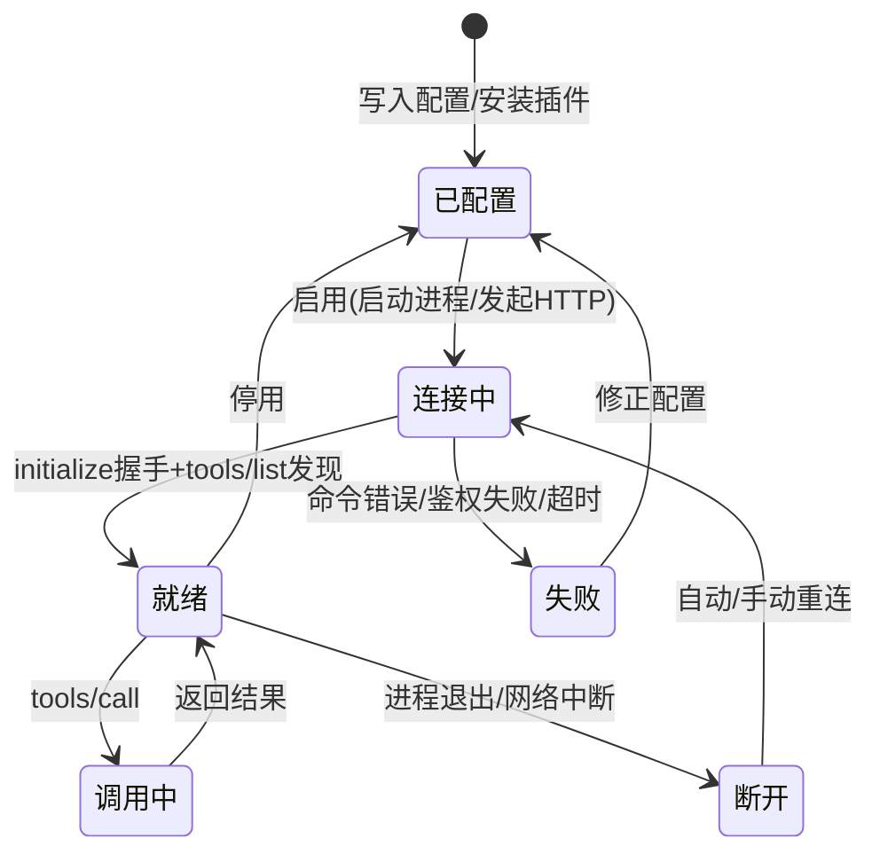

# 连接器（Connector）详解

> 一句话定义：**连接器是 AI 应用与某个外部能力源之间的一条"配置好的连接"——它记录了对方是谁（MCP Server / 浏览器 / 服务）、怎么连（命令或 URL）、凭什么连（凭证），并负责这条连接的生老病死。协议是标准，连接器是按标准接好的那根线。**

系列导航：[Token的详解](../Token/Token的详解.md) → [大模型LLM详解](../LLM大模型/大模型LLM详解.md) → [AI-Agent详解](../Agent智能体/AI-Agent详解.md) → [MCP协议详解](../MCP插件/MCP协议详解.md) → [插件详解](../MCP插件/插件详解.md) / [Skill详解](../Skill技能/Skill详解.md) / **连接器** / [工具集详解](../工具集/工具集详解.md) / [AI平台对比](../AI平台/AI平台对比-Codex-QoderCN-DeepSeekHarness.md)

---

## 1. Why：为什么需要连接器这个概念

### 1.1 协议之外，还有一堆"接线杂活"

MCP 协议规定了通信格式，但真正用起来，每个外部能力源都有一堆个性化问题：

- 这个 Server 用什么命令启动？Python 路径是哪个？
- 远程服务的 URL 是什么？OAuth 令牌放哪？
- 数据库密码怎么传才不进代码库？
- 连接断了要不要重连？Server 崩了怎么提示？
- 这条连接允许哪些操作，谁批准的？

这些**连接级的配置与生命周期管理**，总得有个东西承载——这就是连接器。

### 1.2 类比：驱动与设备管理器

操作系统里，USB 是协议，但每个设备插上后系统要装驱动、分配资源、显示状态、支持拔插。**连接器就是 AI 应用的"设备管理器条目"**：一条连接器 = 一个已登记的外部能力源 + 它的驱动配置 + 运行状态。

### 1.3 没有连接器概念时的乱象

早期各平台把 MCP 配置叫法不一：mcpServers 配置项、integration、extension、connector……本质都是同一件事。理解"连接器"这个抽象层，就能跨平台看懂所有此类配置——**名字会变，职责不变**。

> **为什么值得学：** 你的 Agent 能干什么，取决于接了哪些连接器；连接器配置是日常排障最高频的现场（连不上、鉴权失败、工具不出现）。懂这一层，排障从玄学变工程。

---

## 2. What：连接器是什么与不是什么

### 2.1 核心定义

**连接器 = 连接配置 + 连接实例 + 生命周期管理。**

| 组成 | 内容 |
|------|------|
| **配置** | 名称、传输方式（stdio 命令 / HTTP URL）、环境变量、凭证引用、启用开关 |
| **实例** | 按配置建立的活跃连接（MCP Client ↔ Server 会话） |
| **生命周期** | 启动/连接 → 能力发现 → 就绪 → 调用 → 重连/停用/删除 |

### 2.2 连接器的常见类型

1. **MCP 连接器**（最主流）：对接一个 MCP Server。你 Qoder 环境里的 mongodb、browser-use、office 系列都是。
2. **浏览器连接器**：对接用户已登录的浏览器（如 Qoder Browser Connector），复用登录态操作网页——本质也是"应用 ↔ 外部能力源"的受管连接。
3. **平台内置集成**：知识库、代码仓库、协作平台等官方集成，配置形态类似但协议私有。

本文以 MCP 连接器为主线，其余类型道理相通。

### 2.3 边界：连接器不是什么

- **不是 MCP 协议本身**：协议是通信标准（USB 规范），连接器是按标准建立的连接实例（插好的那根线）。
- **不是工具**：一条连接器通常带来**一组**工具；工具是连接器就绪后发现的产物。
- **不是插件**：插件是分发容器，可以**携带**连接器配置；安装插件 ≠ 连接已建立（可能还需填凭证、点启用）。
- **不是 Server**：Server 是对方程序，连接器是我方对它的登记与连接管理。

---

## 3. How：原理与机制

### 3.1 连接器的生命周期



### 3.2 配置解剖：两种传输形态

**stdio 型（本地进程）**：

```json
{
  "mcpServers": {
    "inventory": {
      "command": "python",
      "args": ["D:/workspace/inventory_server.py"],
      "env": { "DB_PASSWORD": "${INVENTORY_DB_PASSWORD}" }
    }
  }
}
```

要点：`command` 是连接器帮你启动的子进程；`env` 注入凭证；进程随连接生灭。

**HTTP 型（远程服务）**：

```json
{
  "mcpServers": {
    "company-erp": {
      "url": "https://erp.example.com/mcp",
      "headers": { "Authorization": "Bearer ${ERP_TOKEN}" }
    }
  }
}
```

要点：Server 常驻远端，连接器只管会话与鉴权；企业场景常走 OAuth 授权流程。

### 3.3 就绪之后发生什么

1. 握手协商协议版本与能力（见 MCP 文档 3.4）。
2. 拉取工具/资源/提示模板清单。
3. 工具注册进会话的[工具集](../工具集/工具集详解.md)，模型从此"看得见"这些能力。
4. 此后每次模型调用，Host 经这条连接转发 `tools/call`。

**一条连接器 = 一个 MCP Client 实例 ↔ 一个 Server**，1:1 关系；Host 同时维护多条连接器。

### 3.4 凭证与权限的安放

- 凭证放环境变量或系统密钥管理，配置里用引用，**不写明文**。
- 连接器级开关决定"这批工具是否进入工具集"——这是最粗粒度也最有效的权限闸门。
- 细粒度权限（哪些工具要人工确认）由 Host 的权限模式管理，连接器配合提供工具元数据。

---

## 4. Do：动手用起来

### 4.1 添加一条 MCP 连接器

1. 打开平台的 MCP/连接器管理面板（Qoder 在设置中管理 MCP）。
2. 选择本地（stdio）或远程（URL）类型，填配置（见 3.2）。
3. 保存并启用，观察状态变为就绪。
4. 验证：新会话里问一个需要该工具的问题，或查看工具清单是否出现新条目。

### 4.2 排障速查表（高频现场）

| 症状 | 排查顺序 |
|------|----------|
| 连接失败 | ① 终端手动跑 `command` 能否启动 ② 路径是否绝对路径 ③ Python/Node 环境是否正确 |
| 鉴权失败 | ① 环境变量是否真的注入 ② 令牌是否过期 ③ URL 是否要求 OAuth 流程 |
| 连上但没工具 | ① Server 是否实现了 tools/list ② 是否被懒加载（先给目录，用时取 schema）③ 连接器是否被禁用 |
| 工具调用报错 | ① 看 Server 日志 ② 参数是否被模型幻觉 ③ 用 MCP Inspector 单独复现 |
| 时好时坏 | ① 进程是否崩溃重启 ② 网络/代理 ③ Server 超时设置 |

### 4.3 管理好习惯

- 命名见名知义：`inventory-db` 好过 `server1`。
- 不用的连接器**停用**而非删除，配置留档。
- 凭证轮换时只改环境变量/密钥项，不动连接器结构。
- 团队共享配置模板，凭证各自注入。

---

## 5. Where：工程实践中的连接器

### 5.1 典型场景

1. **私有系统接入**：给采购 Agent 接 ERP/库存库连接器，一条配置打通一个系统。
2. **复用登录态**：浏览器连接器让 Agent 操作你已登录的内网页面，免去凭证分发。
3. **环境隔离**：开发/测试/生产各一条连接器指向不同实例，切换环境 = 切换启用的连接器。
4. **能力开关**：按任务启用连接器组合——写文档时只开 office 系，调试时才开浏览器系，省上下文也降风险。

### 5.2 安全要点

1. **连接器是权限边界**：每条连接背后是一个能执行动作的程序/服务，启用前确认来源与权限范围。
2. **第三方 Server 供应链风险**：见 MCP 文档 5.2——连接器让安装变容易，也让引入恶意代码变容易。
3. **凭证最小化**：给连接器的数据库账号只授必要权限（查询类连接器用只读账号）。
4. **审计**：记录哪条连接器在何时被谁启用/调用，企业场景必备。

### 5.3 常见坑

1. **Windows 相对路径/解释器错位**：`python` 指向了错误环境，用绝对路径最稳。
2. **配置改了没重连**：多数平台改配置后需重启连接器或会话才生效。
3. **连接器开太多**：工具清单膨胀吃 Token（见工具集文档的懒加载对策）。
4. **把连接器当插件卸载**：删了连接器配置，插件携带的模板还在，重装插件可能复活旧配置。
5. **远程 Server 无超时控制**：网络抖动时调用悬挂，Host 侧要设超时与重试上限。

---

## 6. Compare：与相邻概念的关系

### 6.1 层次定位

```
插件(分发包) ──携带──▶ 连接器配置
连接器(连接实例) ──遵循──▶ MCP协议(标准)
连接器 ──对接──▶ MCP Server(对方程序)
连接器就绪 ──产出──▶ 工具 ──汇入──▶ 工具集(会话可用清单)
```

### 6.2 易混概念对照

| 对比 | 区别 |
|------|------|
| 连接器 vs MCP | 实例/管理层 vs 协议标准 |
| 连接器 vs Server | 我方登记与连接 vs 对方能力程序 |
| 连接器 vs 插件 | 一条连接 vs 可含多条连接配置的分发包 |
| 连接器 vs 工具集 | 能力的"来源管道" vs 会话中"可用能力汇总" |

---

## 7. Source：一手资料与深入路径

1. **MCP 规范的生命周期与传输章节**（modelcontextprotocol.io）——连接器行为的协议依据。
2. **各平台 MCP 管理文档**：Qoder/Claude Desktop/Cursor 的 MCP 配置说明——对照看"同一抽象的不同实现"。
3. **MCP Inspector**：不经过 Host 直接验证 Server，是区分"连接器问题"与"Server 问题"的关键工具。
4. **动手实验建议**：把 MCP 文档里的库存 Server 分别以 stdio 和 HTTP 两种方式接成两条连接器，故意配错路径观察失败状态，再修正——完整走一遍生命周期。

---

## 8. Future：演进方向

1. **OAuth 标准化**：MCP 规范已纳入 OAuth 2.1 授权框架，远程连接器的企业级鉴权体验将接近"扫码登录"。
2. **注册表一键接入**：官方 MCP Registry 成熟后，添加连接器从"手填 JSON"变成"市场点安装 + 授权"。
3. **健康观测体系**：连接状态、调用延迟、错误率的标准化监控面板，连接器管理向"设备管理器"的成熟度进化。
4. **权限精细化**：连接器级开关之下，工具级、参数级的授权策略逐渐普及。

---

## 自检清单

- [ ] 一句话说清连接器与 MCP 协议的区别
- [ ] 列出连接器的三个组成（配置/实例/生命周期）
- [ ] 画出连接器状态机，说清"就绪"前发生了什么
- [ ] 写出 stdio 与 HTTP 两种配置并解释各字段
- [ ] 独立排查一次"连接失败"（手动跑命令→查路径→查环境）
- [ ] 说清凭证应该怎么放、权限应该怎么收
- [ ] 解释连接器、插件、Server、工具集四者的关系链
- [ ] 为自己的采购系统设计开发/生产两条连接器的隔离方案