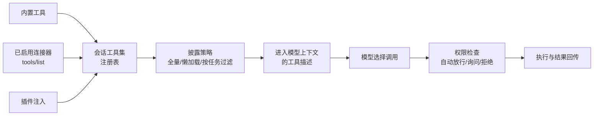

# 工具集（Toolset）详解

> 一句话定义：**工具集是 Agent 在一次会话中实际可调用的全部工具的集合——内置工具、各连接器带来的 MCP 工具、插件注入的工具汇总于此。模型每一轮"能做什么"，由工具集决定；工具集的设计质量，直接决定 Agent 的能力上限与成本下限。**

系列导航：[Token的详解](Token的详解.md) → [大模型LLM详解](大模型LLM详解.md) → [AI-Agent详解](AI-Agent详解.md) → [MCP协议详解](MCP协议详解.md) → [插件详解](插件详解.md) / [Skill详解](Skill详解.md) / [连接器详解](连接器详解.md) / **工具集** / [AI平台对比](AI平台对比-Codex-QoderCN-DeepSeekHarness.md)

---

## 1. Why：为什么工具集值得单独讲

### 1.1 工具不是越多越好

直觉上"给 Agent 的工具越多越强"，实践恰恰相反：

1. **每个工具的描述都占上下文**：名字 + 描述 + 参数 schema，一个工具几十到几百 Token。200 个工具光清单就吃掉上万 Token，每轮都计费。
2. **选择困难症**：候选越多，模型选错工具、幻觉参数的概率越高。功能重叠的工具（两个都能查库）尤其致命。
3. **攻击面扩大**：每个工具都是潜在的危险动作入口，多一个删除工具就多一分风险。

**工具集管理 = 在"能力充足"与"精简可控"之间做工程权衡。** 这是 Agent 调优的核心杠杆之一。

### 1.2 从 Function Calling 到工具集工程

Function Calling 解决"模型如何表达调用"（见 Agent 文档），MCP 解决"工具如何接入"（见 MCP 文档），但都默认"工具清单是给定的"。真实平台必须回答：

- 哪些工具进入本次会话？（装配）
- 什么时候把 schema 给模型？（披露时机）
- 哪些调用要人批准？（权限）
- 工具坏了/超时怎么办？（治理）

这些问题的总和，就是工具集这一层。

> **为什么值得学：** 你给 FastGPT 采购助手配工具、在 Qoder 里开关 MCP，本质都是在设计工具集。理解这层，Agent"变笨了/变贵了/乱调工具"这类问题就有了系统的诊断框架。

---

## 2. What：工具集是什么与不是什么

### 2.1 核心定义

**工具集 = 会话级可用工具的注册表 + 披露策略 + 权限策略。**

每个工具的标准描述三件套（Function Calling 与 MCP 通用）：

```json
{
  "name": "query_inventory",
  "description": "查询指定商品的库存数量。仅支持在库商品名精确匹配。",
  "inputSchema": {
    "type": "object",
    "properties": { "item": { "type": "string" } },
    "required": ["item"]
  }
}
```

### 2.2 工具的三大来源

| 来源 | 例子（以 Qoder 为例） | 特点 |
|------|------------------------|------|
| **平台内置** | Read / Edit / Bash / Grep / WebSearch / Agent | 深度优化，权限体系完善 |
| **MCP 连接器** | mongodb 的 find、browser-use 的 click | 即插即用，质量参差 |
| **插件/Skill 附带** | 插件捆绑的 MCP 工具、Skill 引用的脚本 | 随包分发，成套出现 |

### 2.3 你身边的真实工具集

当前 Qoder 会话的工具集构成：内置工具（Read/Edit/Bash/Task 系列等）+ 十余个 MCP 服务器的数百个工具。注意平台采用了**懒加载**：MCP 工具不直接全量展开，而是先给一份"目录"（mcp_list 可检索），需要时 mcp_get 取 schema、mcp_call 调用——这就是工具集披露策略的活例子（见 3.2）。

### 2.4 边界：工具集不是什么

- **不是 Function Calling**：那是模型表达调用的格式；工具集是"有哪些可调用"的管理层。
- **不是连接器**：连接器是来源管道，工具集是汇总结果；一条连接器贡献一组工具。
- **不是 Skill**：Skill 是"怎么做的知识"，工具是"能做的动作"；Skill 指挥工具的使用。

---

## 3. How：原理与机制

### 3.1 工具集的装配流水线



### 3.2 披露策略：全量 vs 懒加载

| 策略 | 做法 | 代价 | 适用 |
|------|------|------|------|
| **全量披露** | 所有工具 schema 直接进上下文 | Token 贵、选择难 | 工具少（<20）的专用 Agent |
| **懒加载** | 先给工具目录，用时取 schema 再调用 | 多一轮发现开销 | 工具多的通用平台（Qoder 现行方案） |
| **按任务过滤** | 根据任务类型只披露相关子集 | 需要路由逻辑 | 多场景平台、子代理 |

子代理是过滤策略的典型应用：Qoder 的 Explore 代理只拿只读搜索工具，不给 Edit/Bash 写权限——**工具集裁剪既是省钱手段，也是权限手段**。

### 3.3 权限层：工具调用的闸门

工具集常与权限模式联动：

- **自动放行**：只读类（Read/Grep/find）低风险，直接执行。
- **询问确认**：写文件、跑命令、外部副作用操作，逐次或按规则批准。
- **禁止**：黑名单工具或越权参数直接拒绝。

这呼应 Agent 文档的护栏原则：**模型提议、宿主执行，执行前过闸。**

### 3.4 工具描述的质量工程

模型选工具全靠 description，它本质是**写给模型看的 API 文档**：

- 写清"做什么 + 不做什么 + 何时用"（"仅支持精确匹配"能避免模型拿模糊词乱查）。
- 参数描述给格式与示例（"日期格式 YYYY-MM-DD"）。
- 功能重叠的工具合并或明确分工，别让模型猜。

---

## 4. Do：动手用起来

### 4.1 盘点与裁剪你的工具集

1. 列出当前会话可用工具（Qoder 可用 mcp_list 查看 MCP 工具目录）。
2. 按任务标记：本次任务用得到的 / 用不到的。
3. 停用无关连接器，让工具集瘦身。
4. 对比瘦身前后的响应质量与 Token 用量（usage 字段）。

### 4.2 为自己的 Agent 设计工具集

以采购助手为例，最小够用集：

| 工具 | 来源 | 权限 |
|------|------|------|
| query_inventory | 自建 MCP | 自动放行（只读） |
| get_price | 自建 MCP | 自动放行（只读） |
| create_quote | 自建 MCP | 询问确认（产生文件） |
| search_knowledge | FastGPT 知识库 | 自动放行（只读） |

刻意**不给**：删除、下单、发消息类工具——需求没到就不开，开了也要人工确认。

### 4.3 调试速查表

| 症状 | 大概率原因 | 对策 |
|------|------------|------|
| 模型不调工具，硬编答案 | 工具没进上下文/描述不匹配 | 查披露清单；改 description |
| 总选错工具 | 功能重叠、描述含糊 | 合并工具或写清分工 |
| 参数幻觉 | schema 描述缺格式约束 | 参数描述加格式与示例 |
| 每轮都很贵 | 工具清单膨胀 | 懒加载/裁剪连接器 |
| 调用被拒 | 权限模式拦截 | 查权限规则，按需放行 |

---

## 5. Where：工程实践中的工具集

### 5.1 典型场景

1. **专用 Agent 瘦身**：客服 Agent 只给检索 + 工单查询，不给 Bash——能力刚好、风险最小、成本最低。
2. **多代理分工**：主代理管规划，子代理各拿裁剪后的工具集（搜索型/编码型/审查型）。
3. **环境分级**：生产环境工具集只含只读工具，写操作走独立的审批通道。

### 5.2 常见坑

1. **"全家桶"心态**：把所有 MCP 都开着，以为有备无患——实际又贵又笨又危险。
2. **工具粒度失当**：一个"万能数据库工具"参数复杂易幻觉；拆成 find/aggregate/count 等语义清晰的小工具反而更稳（参考 mongodb MCP 的拆法）。
3. **返回结果不设限**：工具一次回传几万行撑爆上下文，Server 侧要分页/截断。
4. **忽视工具结果注入**：工具返回的外部内容可能含攻击指令（见 Agent 文档 5.3），工具集越大暴露面越大。
5. **描述与实现脱节**：描述说"支持模糊搜索"实现却只精确匹配，模型反复失败重试烧钱。

---

## 6. Compare：设计取舍对比

### 6.1 大工具集 vs 小工具集

| 维度 | 大而全 | 小而专 |
|------|--------|--------|
| 能力覆盖 | 广 | 窄但深 |
| Token 成本 | 高 | 低 |
| 选择准确率 | 低 | 高 |
| 攻击面 | 大 | 小 |
| 适合 | 通用平台（配懒加载） | 生产专用 Agent |

### 6.2 声明式工具 vs 代码化工具（新趋势）

- **声明式（主流）**：JSON schema 描述工具，模型逐次发起调用。多步流程要多轮往返。
- **代码化（PTC，Programmatic Tool Calling）**：把工具暴露为 SDK，让模型**写一段代码**组合调用（循环、分支一次表达）。DeepSeek Harness 的 PTC 模式是代表——复杂编排更省轮次，但对模型编码能力要求更高，执行沙箱要求也更严。

---

## 7. Source：一手资料与深入路径

1. **OpenAI Function Calling 指南**——工具描述写作的官方最佳实践。
2. **Anthropic 工具使用文档与 Building Effective Agents**——工具设计与 Agent 编排的工程建议。
3. **MCP 规范的 Tools 章节**——工具元数据、注解（只读/破坏性提示）的标准字段。
4. **现成范本**：对照你环境里 mongodb MCP 的工具拆分粒度与描述写法，体会"语义清晰的小工具"设计。
5. **动手实验建议**：给采购 Agent 分别配 3 工具与 15 工具两个版本，跑同一组 10 个问题，记录选错率与 Token 用量——亲手验证"少即是多"。

---

## 8. Future：演进方向

1. **动态工具集**：按任务阶段实时装配/卸载工具，披露策略智能化。
2. **工具注解标准化**：只读/破坏性/幂等等元数据普及，权限闸门可自动推导。
3. **代码化工具调用扩散**：PTC 类方案在强编码模型上成熟，复杂编排从"多轮对话"变"一段程序"。
4. **工具质量生态**：市场出现工具级评分与基准测试，"好工具"有客观标准。

---

## 自检清单

- [ ] 一句话说清工具集是什么、为什么不是越多越好
- [ ] 列出工具三大来源并各举一例
- [ ] 画出装配流水线，说清披露与权限两道关卡
- [ ] 对比全量披露与懒加载的成本与适用场景
- [ ] 解释子代理工具裁剪为什么既是省钱也是权限手段
- [ ] 为采购助手设计一个最小够用工具集并说明不给哪些工具
- [ ] 诊断"模型不调工具/选错工具/参数幻觉"三类问题
- [ ] 说清声明式与代码化（PTC）工具调用的区别